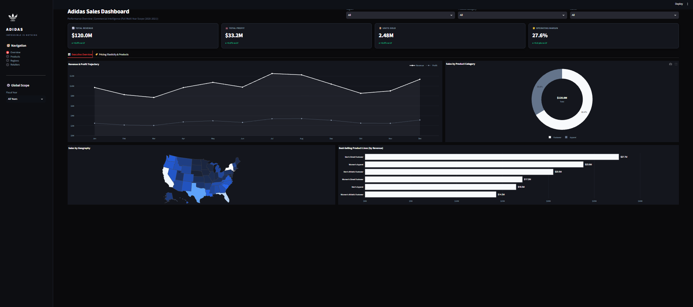
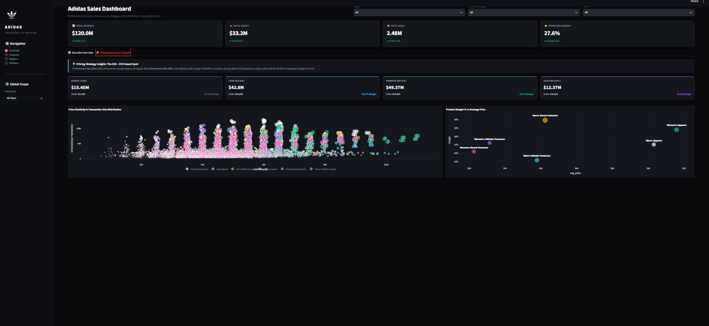
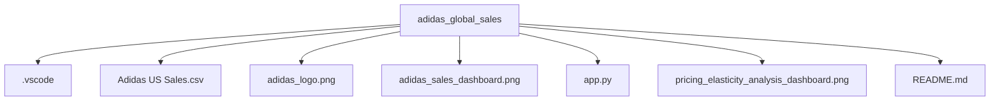

# Adidas Executive Commercial Intelligence & Pricing Elasticity Dashboard

An executive-level commercial analytics platform built with Streamlit and Plotly to analyze $120.0M in revenue, $33.2M in operating profit, and 2.48M units sold across 9,637 multi-channel transactions[cite: 9]. Designed with a custom obsidian dark design system, the application delivers actionable business intelligence across two core views: Executive Overview and Pricing Elasticity & Products[cite: 9].

## 📸 Executive Dashboard Views

### 1. Executive Performance Overview
Comprehensive multi-year financial trajectory, geographic sales distribution, product category breakdown, and top-performing revenue drivers[cite: 2, 4].

### 2. Pricing Elasticity & Margin Optimization
Granular analysis of transaction-level price elasticity, price-tier performance, and operating margin sensitivity[cite: 9, 10].

## 💼 Key Strategic Insights

* **The $50–$70 Sweet Spot:** The **Premium tier ($50–$70)** serves as the core profit engine, generating **$49.37M (41.1% of total revenue)** at the portfolio's highest operating margin of **29.5%**[cite: 9].
* **High-End Margin Compression:** Pricing above **$70** leads to severe volume erosion (150,538 units) and margin contraction to **26.4%**, reflecting promotional clearance pressures and consumer resistance[cite: 9].
* **Footwear Market Dominance:** Footwear drives over **66%** of total revenue in peak periods, led by **Men's Street Footwear** ($27.7M multi-year revenue at a 29.9% operating margin)[cite: 2, 9].
* **Channel Sensitivity Variance:** Outlet shoppers demonstrate high elasticity ($PED > 1.0$), rewarding promotional discount tiers, while in-store physical retail captures higher average price points ($48.82) and peak transaction profitability (35.8%).

## 📐 Data Architecture & Metric Definitions

The analytics pipeline ingests and processes `Adidas US Sales.csv` across the following core metrics[cite: 10]:

* **Operating Margin (%):** `(Total Operating Profit / Total Sales) * 100`[cite: 9]
* **Year-over-Year (YoY) Growth (%):** `((Current Year Value - Prior Year Value) / Prior Year Value) * 100`[cite: 2]
* **Price Elasticity of Demand (PED):** `% Change in Units Sold / % Change in Price per Unit`[cite: 9]

### Commercial Price Tier Segmentation

| Tier | Price Range | Units Sold | Total Revenue | Operating Margin | Strategic Mandate |
| :--- | :--- | :--- | :--- | :--- | :--- |
| **Budget** | < $35 | 541,601 | $15.45M | 25.4% | Volume acquisition & market penetration |
| **Core** | $35 – $50 | 959,088 | $42.80M | 26.7% | High-turnover mass market assortment |
| **Premium** | $50 – $70 | 824,384 | $49.37M | 29.5% | Primary margin & revenue driver |
| **High-End** | $70+ | 150,538 | $12.37M | 26.4% | Specialized & premium capsule drops |

## 🛠️ Technology Stack

* **Framework:** Streamlit (`st.tabs`, `st.sidebar`, `st.columns`, `st.cache_data`)[cite: 9]
* **Visualization:** Plotly Graph Objects (`go.Scatter`, `go.Pie`, `go.Bar`) and Plotly Express (`px.choropleth`, `px.scatter`)[cite: 2, 9]
* **Data Manipulation:** Python, Pandas, NumPy[cite: 5, 8]
* **Styling:** Custom Obsidian Dark CSS (`#0A0A0C` background, `#14161D` containers, `#232733` borders) and vector branding[cite: 8, 9]

## 📂 Repository Structure

## 🚀 Setup & Execution

1. **Clone the Repository:**
   `git clone https://github.com/<your-username>/adidas_global_sales.git`
   `cd adidas_global_sales`

2. **Install Dependencies:**
   `py -m pip install streamlit plotly pandas numpy`

3. **Launch Dashboard:**
   `py -m streamlit run app.py`

Navigate to `http://localhost:8501` in your browser[cite: 4]. Use the top navigation tabs to alternate between the **Executive Overview** and **Pricing Elasticity & Products** views[cite: 9].

## 👤 Author

**Ashutosh Tembhekar**
* Data Analytics Specialist