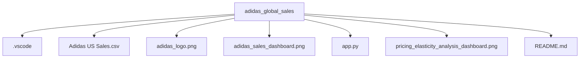

# Adidas Executive Commercial Intelligence & Pricing Elasticity Dashboard

An executive-level commercial analytics platform built with Streamlit and Plotly to analyze $120.0M in revenue, $33.2M in operating profit, and 2.48M units sold across 9,637 multi-channel transactions. Designed with a custom obsidian dark design system, the application delivers actionable business intelligence across two core views: Executive Overview and Pricing Elasticity & Products.

## 📸 Executive Dashboard Views

### 1. Executive Performance Overview
Comprehensive multi-year financial trajectory, geographic sales distribution, product category breakdown, and top-performing revenue drivers.

### 2. Pricing Elasticity & Margin Optimization
Granular analysis of transaction-level price elasticity, price-tier performance, and operating margin sensitivity.

## 💼 Key Strategic Insights

* **The $50–$70 Sweet Spot:** The **Premium tier ($50–$70)** serves as the core profit engine, generating **$49.37M (41.1% of total revenue)** at the portfolio's highest operating margin of **29.5%**.
* **High-End Margin Compression:** Pricing above **$70** leads to severe volume erosion (150,538 units) and margin contraction to **26.4%**, reflecting promotional clearance pressures and consumer resistance.
* **Footwear Market Dominance:** Footwear drives over **66%** of total revenue in peak periods, led by **Men's Street Footwear** ($27.7M multi-year revenue at a 29.9% operating margin).
* **Channel Sensitivity Variance:** Outlet shoppers demonstrate high elasticity ($PED > 1.0$), rewarding promotional discount tiers, while in-store physical retail captures higher average price points ($48.82) and peak transaction profitability (35.8%).

## 📐 Mathematical Formulation & Financial Metrics

The data processing pipeline formalizes commercial performance, growth kinetics, and price sensitivity using the following equations:

### 1. Financial Performance & Commercial Margin
For a transaction set $T$, where each transaction $i \in T$ has price per unit $P_i$, units sold $Q_i$, total revenue $R_i = P_i \cdot Q_i$, and operating profit $\Pi_i$:

$$\text{Total Revenue } (R) = \sum_{i \in T} P_i \cdot Q_i$$

$$\text{Total Operating Profit } (\Pi) = \sum_{i \in T} \Pi_i$$

$$\text{Operating Margin } (OM) = \left( \frac{\Pi}{R} \right) \times 100 = \left( \frac{\sum_{i \in T} \Pi_i}{\sum_{i \in T} P_i \cdot Q_i} \right) \times 100$$

### 2. Year-over-Year (YoY) Growth Kinetics
Let $M_{\text{CY}}$ denote any aggregated metric in Current Year (2021) and $M_{\text{PY}}$ in Prior Year (2020):

$$\Delta M_{\text{YoY}} (\%) = \left( \frac{M_{\text{CY}} - M_{\text{PY}}}{M_{\text{PY}}} \right) \times 100$$

$$\Delta OM_{\text{YoY}} (\text{pts}) = OM_{\text{CY}} - OM_{\text{PY}}$$

### 3. Log-Log Econometric Price Elasticity of Demand (PED)
Demand responsiveness across sales channels and product lines is estimated via Ordinary Least Squares (OLS) regression over the log-transformed demand curve:

$$\ln(Q_i) = \alpha + \beta \ln(P_i) + \varepsilon_i$$

Where:
* $Q_i$ = Quantity sold in transaction $i$
* $P_i$ = Unit price in transaction $i$
* $\alpha$ = Baseline constant (log scale volume intercept)
* $\varepsilon_i$ = Residual disturbance term ($\varepsilon_i \sim \mathcal{N}(0, \sigma^2)$)

The empirical price elasticity coefficient $\beta$ represents the point elasticity of demand:

$$PED = \beta = \frac{d \ln(Q)}{d \ln(P)} = \frac{\left( \frac{dQ}{Q} \right)}{\left( \frac{dP}{P} \right)} = \frac{\% \Delta Q}{\% \Delta P}$$

**Empirical Parameter Estimation:**

$$\beta = \frac{N \sum (\ln P_i \cdot \ln Q_i) - \left(\sum \ln P_i\right)\left(\sum \ln Q_i\right)}{N \sum (\ln P_i)^2 - \left(\sum \ln P_i\right)^2}$$

* $\vert{}PED\vert{} > 1.0 \implies$ **Elastic Demand** (e.g., Outlet Apparel & Outlet Footwear: price drops yield proportionately higher volume).
* $\vert{}PED\vert{} < 1.0 \implies$ **Inelastic Demand** (e.g., Online channels: price adjustments yield minimal volume displacement).

### 4. Commercial Price Tier Segmentation

| Tier | Price Range | Units Sold | Total Revenue | Operating Margin | Strategic Mandate |
| :--- | :--- | :--- | :--- | :--- | :--- |
| **Budget** | < $35 | 541,601 | $15.45M | 25.4% | Volume acquisition & market penetration |
| **Core** | $35 – $50 | 959,088 | $42.80M | 26.7% | High-turnover mass market assortment |
| **Premium** | $50 – $70 | 824,384 | $49.37M | 29.5% | Primary margin & revenue driver |
| **High-End** | $70+ | 150,538 | $12.37M | 26.4% | Specialized & premium capsule drops |

## 🛠️ Technology Stack

* **Framework:** Streamlit (`st.tabs`, `st.sidebar`, `st.columns`, `st.cache_data`)
* **Visualization:** Plotly Graph Objects (`go.Scatter`, `go.Pie`, `go.Bar`) and Plotly Express (`px.choropleth`, `px.scatter`)
* **Data Manipulation:** Python, Pandas, NumPy
* **Styling:** Custom Obsidian Dark CSS (`#0A0A0C` background, `#14161D` containers, `#232733` borders) and vector branding

## 📂 Repository Structure

## 🚀 Setup & Execution

1. **Clone the Repository:**
   `git clone https://github.com/<your-username>/adidas_global_sales.git`
   `cd adidas_global_sales`

2. **Install Dependencies:**
   `py -m pip install streamlit plotly pandas numpy`

3. **Launch Dashboard:**
   `py -m streamlit run app.py`

Navigate to `http://localhost:8501` in your browser. Use the top navigation tabs to alternate between the **Executive Overview** and **Pricing Elasticity & Products** views.

## 👤 Author

**Ashutosh Tembhekar**
* Data Analytics & Engineering
